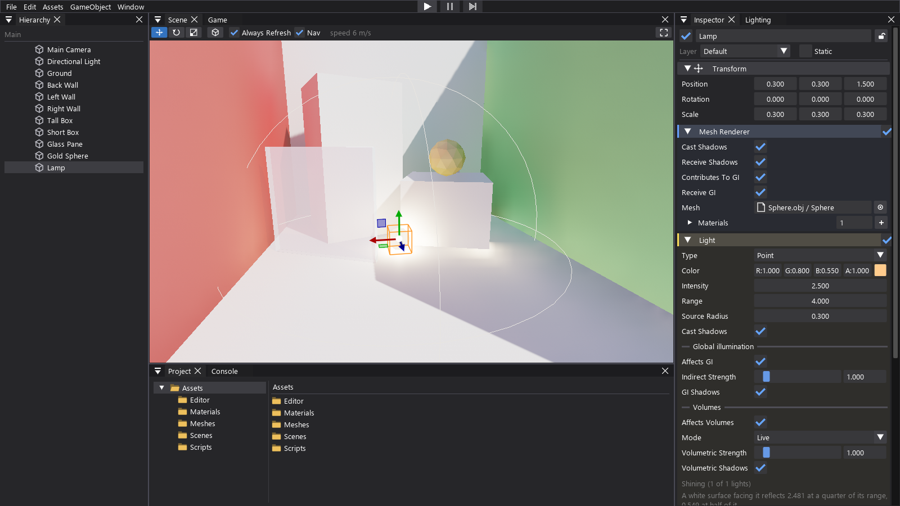
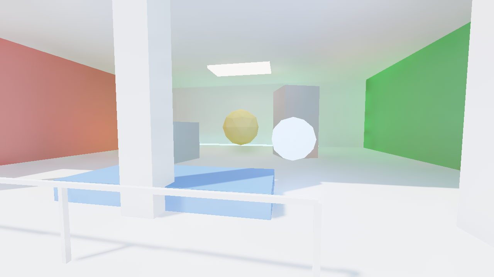
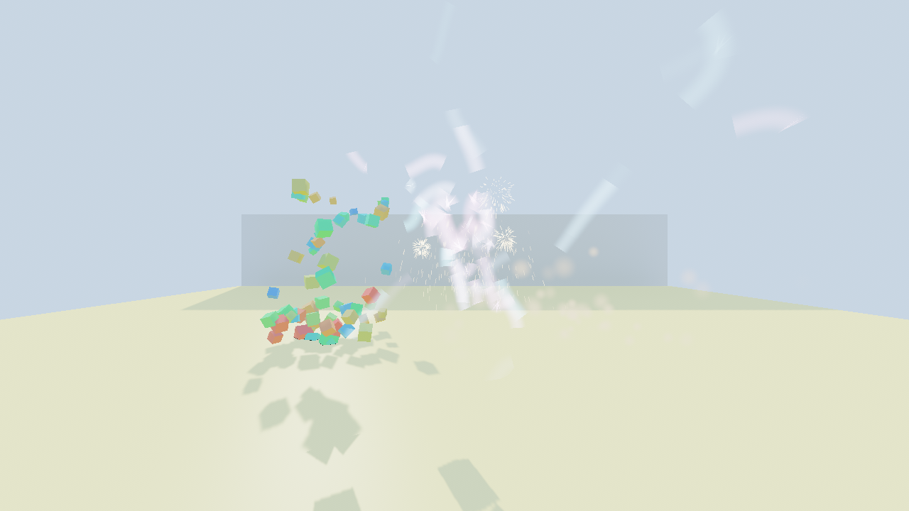
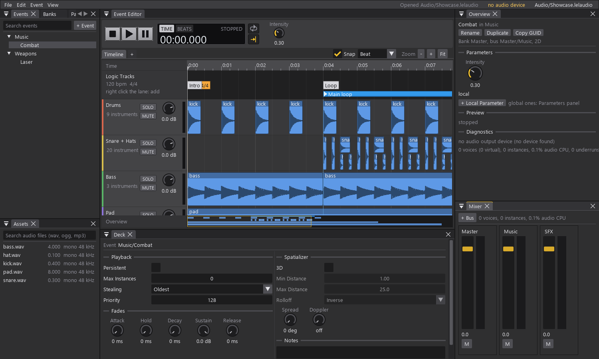
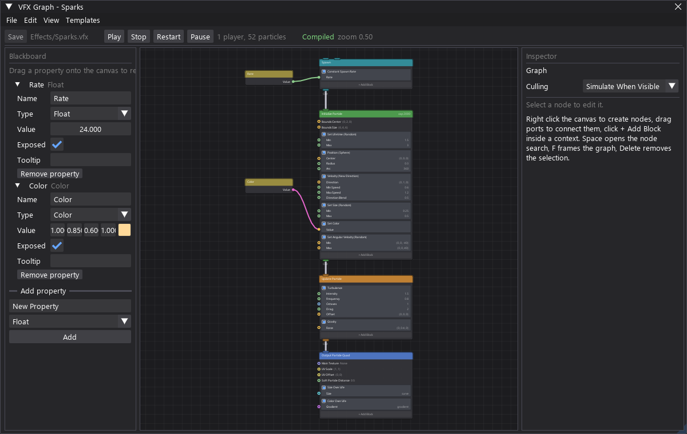

# LELEngine

A C# game engine with a Unity-like workflow: GameObjects and components, prefabs and ScriptableObjects, an editor
with scene and game views and play mode, and a standalone player for game builds. Built on .NET 10 and the BRUTAL
framework (GLFW, OpenGL and Vulkan bindings); renders on OpenGL 4.3+ or Vulkan 1.3.



## Features

- **Scene model**: a Transform hierarchy, `Behaviour` components with Unity's lifecycle and `[ExecuteAlways]`. Scenes
  and assets are readable JSON in the editor and a binary format in builds; assets are referenced by GUID through
  `.meta` files. Prefabs with variants, nesting and overrides, ScriptableObjects, `Resources`, async scene loading.
  Destroyed objects read as null in every null check (`?.`, `??`, `is null` too).
- **Assets**: models (FBX, glTF, OBJ and more through Assimp), textures (2D, 3D, cubemaps, sprites), materials of typed
  shader properties, mesh assets.
- **Animation**: clips of any field or property, an `Animator` with state machines, layers and blend trees, a Timeline
  with a logic track, procedural camera shake.
- **Rendering**: GPU-driven geometry (compute culling, multi-draw indirect), cascaded shadows for several directional
  lights, camera stacking, PBR, transparency with translucent shadows, refraction, shader variants from material
  keywords, LOD groups, impostors, trails, custom renderers.
- **Global illumination**: voxel cone tracing or a Lumen-style mode (distance fields, surface cache, radiance cache,
  screen probes). On Vulkan with ray queries, hardware ray tracing for the GI's rays, shadows and reflections.
- **GPU particles**: VFX Graph-style graphs compiled to compute shaders, GPU events between systems; a million
  particles update in 0.15 ms on an RTX 3080 Ti.
- **2D physics**: Box2D v3 (Box2D.NET) on worker threads, in the XY or XZ plane, with Unity's 2D physics API.
- **Audio**: FMOD Studio-style events (timelines, parameter sheets, logic markers, snapshots, buses, banks) on a mixer
  thread of its own.
- **Input**: Rewired-style actions and controller maps, remapping, gamepads assigned automatically.
- **UI**: UI Toolkit-style UXML and USS, flexbox layout, SDF text, data binding.
- **Navigation**: tiled navmesh surfaces, carving obstacles, crowd agents, NavMesh queries.

**Editor**
- Dockable Dear ImGui interface: hierarchy, inspector, project browser, console, undo, gizmos, multi-selection.
- Windows for animation (Animator, Animation, Timeline), Audio Studio, Input Manager, VFX Graph, UI Builder, Mesh
  Baker and Test Runner.
- Files changed outside the editor reload by themselves; an open scene with unsaved changes merges the file's changes
  and asks only about conflicts.
- Game scripts compile in the background; editor scripts and unit tests (below).
- Standalone game builds (optionally compiled ahead of time), also headless in batch mode on Windows and Linux.
- Automation: `LELEngine.Editor.Console` drives a running editor (clicks, inspector values, menus, play mode, window
  screenshots).

| | |
| --- | --- |
|  |  |
|  |  |

## Repository layout

| Folder | Contents |
| --- | --- |
| `LELEngine` | Engine runtime |
| `LELEngine.Editor` | The editor application |
| `LELEngine.Player` | Generic player executable used by game builds |
| `LELEngine.TestFramework` | The games' unit test framework (`LELEngine.Testing`) |
| `TestGame`, `TestGame.Scenes` | Test and measurement harness and its scenes |
| `LELEngine.Benchmarks` | Headless benchmarks (`physics2d`, `physics2d-scene`) |

## Building and running

Requirements: the .NET 10 SDK, Windows, a GPU with OpenGL 4.3 or newer.

```bash
dotnet build LELEngine.sln -c Release
dotnet run --project LELEngine.Editor -c Release        # the editor, opens the project launcher
dotnet run --project TestGame -c Release -- gi=lumen    # a test scene built in code
```

TestGame options: `gi=lumen|vct|0`, `ui=1`, `nav=1`, `physics=1`, `vfx=1`, `outdoor=1`, `stats=1` (timings),
`exitseconds=S`, `graphics=opengl|vulkan`.

## Writing components

Scripts go in `Assets/Scripts` of an editor project and compile when saved:

```csharp
using LELEngine;

public sealed class Spinner : Behaviour
{
	public float Speed = 90f;

	public override void Update()
	{
		transform.rotation *= QuaternionHelper.Euler(0f, Speed * Time.deltaTime, 0f);
	}
}
```

`Destroy(gameObject)` takes the object out of the game at once (no more updates, callbacks or queries) and finishes it
at the end of the frame (`OnDisable`, `OnDestroy`, the `Destroyed` event). The editor rewrites the compiled scripts so
that a destroyed object is null in every null check, not only `==`; `EngineObject.IsNullReference` is the plain test.

## Editor scripts

Scripts in any `Editor` folder under `Assets` build into `Game.Editor.dll` and never reach a player build. They use
the game scripts, `LELEngine.Editor` and Dear ImGui (`Hexa.NET.ImGui`): custom inspectors (`[CustomEditor]`,
`OnInspectorGUI`, `OnSceneGUI`), editor windows (`EditorWindow`, `GetWindow<T>`), menu items (`[MenuItem]`),
`EditorGUILayout`, `Undo`, `Selection` and node graphs (`LELEngine.Editor.Graphs.GraphView`).

```csharp
using Hexa.NET.ImGui;
using LELEngine.Editor;

[CustomEditor(typeof(Spinner))]
public class SpinnerEditor : Editor
{
	public override void OnInspectorGUI()
	{
		var spinner = (Spinner)target;
		PropertyField("Speed");
		if (ImGui.Button("Double speed"))
		{
			Undo.RecordObject(spinner, "Double speed");
			spinner.Speed *= 2f;
		}
	}
}
```

## Unit tests

Scripts in any `Tests` folder under `Assets` build into `Game.Tests.dll`, never into a player build. NUnit's
attributes and asserts (`[Test]`, `[TestCase]`, `[SetUp]`, `Assert.AreEqual`, ...), Unity's `LogAssert`, and async
tests that wait for frames (`await TestContext.NextFrame()`). **Window > Test Runner** runs and debugs them; on a
build machine:

```bash
LELEngine.Editor.Console -batchmode -projectPath MyGame -runTests -testResults results.xml
```

`-testFilter` and `-testCategory` pick tests, `-testResults` writes JUnit XML, the exit code is 1 when a test fails.
