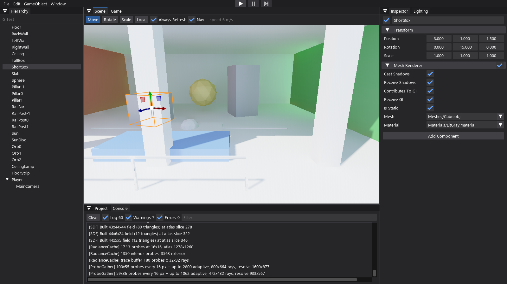
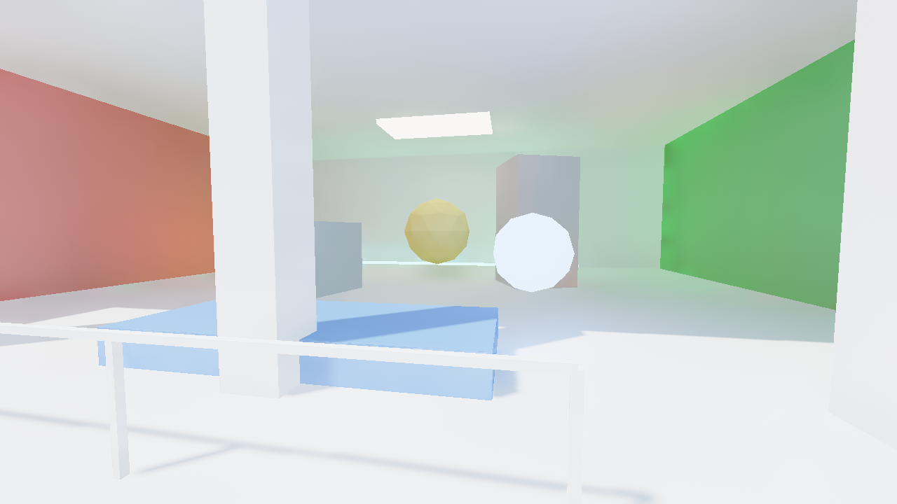
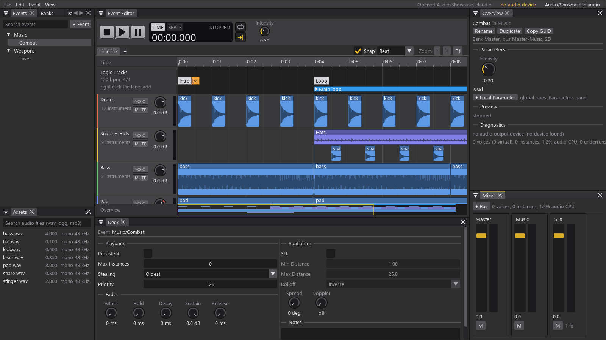
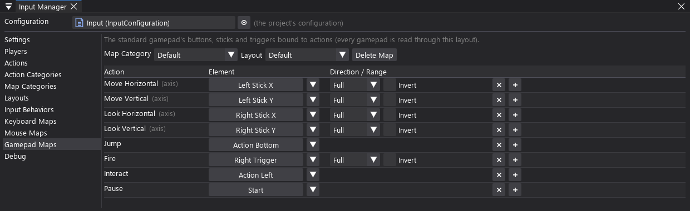
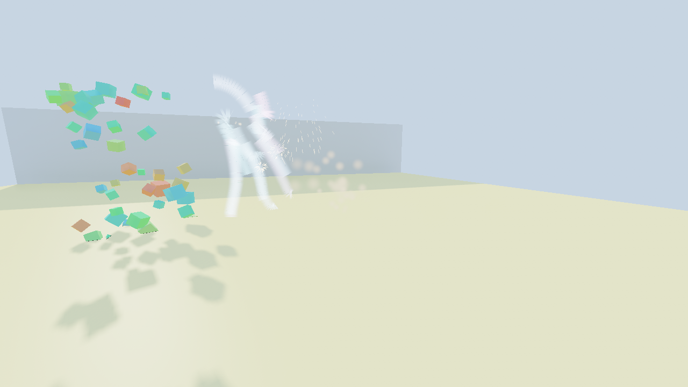
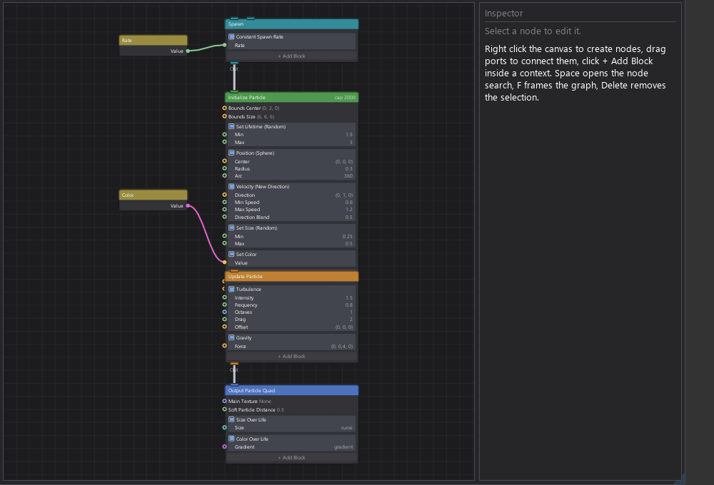
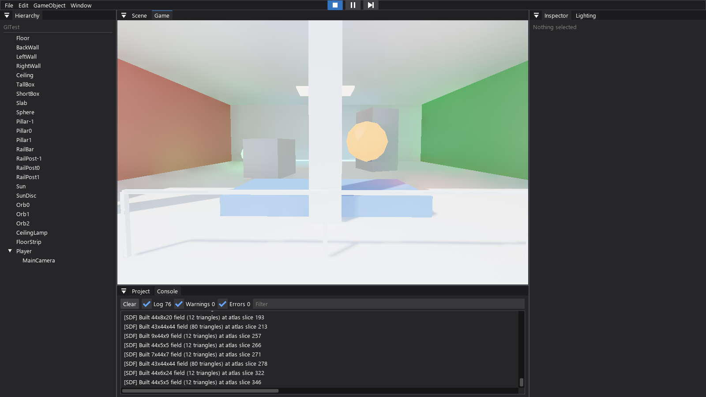

# LELEngine

A C# game engine with a Unity-like workflow: GameObjects and components, prefabs and ScriptableObjects, an editor
with scene/game views and play mode, a standalone player for game builds, Lumen-inspired real-time global
illumination, a VFX Graph-style GPU particle system with a node editor, an FMOD Studio-style audio system, a
Rewired-style input system, a UI Toolkit-style UI system and Recast/Detour-style navigation. The editor can be driven
from code and the command line (automation, window screenshots) and builds games headless on Windows and Linux.

Built on .NET 10, OpenTK 4.9 (GLFW) and OpenGL 4.6 (4.3 minimum), developed and tuned on an Intel integrated GPU.


*The editor: hierarchy, scene view with the move gizmo on the selected object, inspector and project browser.*

## Features

**Scene model**
- GameObjects with a Transform hierarchy and `Behaviour` components (`Awake`, `OnEnable`, `Start`, `Update`,
  `LateUpdate`, `OnDisable`, `OnDestroy`, `[ExecuteAlways]`).
- Destroyed objects are null for game scripts in every form of null check, `?.` and `??` included, through
  interfaces too (see [Destroying objects](#destroying-objects)); a `Destroyed` event on every object and component.
- Public and `[SerializeField]` fields are serialized into scenes. One document model, two encodings: the editor
  writes readable JSON (scenes, materials, `.meta` files, physics materials), game builds convert every document
  to the fast binary form (LELB: schema tables, polymorphic values, bulk arrays). The conversion needs no types
  loaded, so a build never runs game code.
- Assets are referenced by GUID from `.meta` sidecar files (`AssetDatabase`), which also hold import settings.
  Renaming or moving an asset in the editor keeps every reference.
- Fields can hold interfaces and abstract types (polymorphic, a type picker in the inspector), dictionaries and nested
  collections; `[SerializeReference]`-style inline objects need no attribute.
- Prefabs as in Unity: variants, nested prefabs and per-instance overrides of fields, list elements and dictionary
  entries, added and removed components and objects; apply and revert per property or per instance, prefab mode with
  auto save, unpacking. Instances rebuild from the prefab file when it changes. `Prefab.Instantiate` at runtime.
- `ScriptableObject` data assets (`[CreateAssetMenu]`, edited in the inspector or inline with `[InlineEditor]`),
  `Resources.Load` / `LoadAll` and `Resources.LoadAsync` (read on a loading thread, uploaded within a frame budget).
- Scenes load synchronously or with `SceneManager.LoadSceneAsync` (single or additive, activation held until
  allowed): the document and its assets are read on a loading thread, textures decode on worker threads, shaders
  compile together, the GPU uploads are spread over frames. Every load logs where its time went.
- Component lookups take interfaces: `GetComponent<IDamageable>()`, `GetComponentInChildren` / `InParent` (and the
  plural forms), with inactive objects on request. `AnimationCurve` and `Gradient` with Unity's API and inspector
  editors (curve editor with tangent handles, presets and wrap modes).

**Animation**
- `AnimationClip` assets (`.anim`) animate any serialized field, C# property or transform channel of a hierarchy
  (floats, ints, bools, enums, vectors, rotations as Euler angles or quaternions, colors, strings, object references,
  nested paths like `stats.hp` or `items[2]`), with events carrying a float, int, string, object or any serializable
  payload class. Curves are flat arrays: builds copy them as blocks, playback samples them with segment hints.
- `Animator` + `AnimatorController` assets (`.animator`) as in Unity and more: parameters of any serializable type
  (floats, ints, bools, triggers, vectors, colors, strings, object and asset references, your own classes), layers
  with masks (override or additive), state machines with sub-machines (nested in place, or any other `.animator`
  asset playing inside a node, its parameters fed from the owner's by a mapping and the rest private per animator),
  Any State and Entry transitions, blend trees
  (1D, 2D directional and cartesian, direct), transitions with exit time (cycles or seconds), durations, offsets,
  interruptions, solo / mute, conditions comparing a parameter with a value or another parameter, "any of" groups
  and script conditions, state behaviours (`StateMachineBehaviour` scripts with per-animator fields), root motion,
  write defaults, speed and motion-time parameters, `Play` / `CrossFade`, live edits that keep the playing state.
  Animators of a scene evaluate in parallel on worker threads; poses and callbacks are applied in scene order.
- Editor: the Animator window (a node graph of the state machine with breadcrumbs for sub-machines and blend trees,
  drag a node's handle to make a transition, drop clips to make states, grouping, notes, auto layout, minimap, undo
  for everything, problems list, and in play mode the current state, transition progress and blend weights of the
  selected object's animator, with its parameters live) and the Animation window (dope sheet and curves, events lane,
  property picker over the target hierarchy, preview on the object in edit mode, record mode that keys what you change).
- Textures: 2D, 3D (slice grids), cubemaps (crosses, strips, panoramas, HDR) and sprites (single or sliced sheets),
  configured per file like Unity's texture importer. Materials are documents of typed properties declared by the
  shader's `//Properties` block.
- Built-in assets: the engine's shaders (`Engine/Lit.shader`, ...), the primitive meshes (`Engine/Meshes/Cube.obj`,
  `Sphere.obj`, `Quad.obj`) and the default material (`Engine/Materials/Default.material`) sit next to the engine
  binaries, read-only and always available in every project and player (like Unity's built-in resources); projects
  get no copies, references store the path.
- Models: `.fbx`, `.gltf` / `.glb`, `.dae`, `.3ds`, `.blend`, `.ply`, `.stl` (imported by the editor with Assimp,
  through Silk.NET.Assimp) and `.obj` with `.mtl` (a built-in reader). A model file is a `Model` asset: its node
  hierarchy and meshes, which are sub-assets (`Car.fbx` / `Wheel`). Meshes are indexed with sub-meshes; a
  `MeshRenderer` has one material per sub-mesh, opaque and transparent ones mixed. Import settings live in the
  `.meta` file (scale, unit conversion, root rotation, normals and smoothing angle, UV flip, materials). Imports are
  cached in `Library/ModelCache`; the materials of a model become `.material` assets (`Materials/` next to it,
  `LitTextured` with its albedo and normal maps; embedded textures go to `Textures/`). Builds ship the imported
  data under the model's own name, so the player has no importer.

**2D physics (Box2D v3)**
- Box2D v3 in pure C# (Box2D.NET): soft-step solver with sub-steps, sleeping islands, continuous collision, and
  the step spread over worker threads (`Physics2DSettings.WorkerCount`, automatic by default).
- Simulates in the XY plane (side views) or the XZ plane (top-down), a project setting: the same 2D API and
  results in both, with transforms mapped into the chosen plane.
- `Rigidbody2D`, `BoxCollider2D`, `CircleCollider2D`, `CapsuleCollider2D`, `PolygonCollider2D`, `EdgeCollider2D`,
  joints (distance, spring, hinge, slider, fixed, wheel, friction, relative, target), `PhysicsMaterial2D` assets,
  layers with a collision matrix.
- The `Physics2D` API: raycasts, linecasts, overlaps, circle and box casts; `OnCollision*2D` / `OnTrigger*2D`
  callbacks on every component; fixed-step simulation with optional transform interpolation.

**Rendering**
- Pass-based renderer: HDR target, depth prepass, cascaded directional shadow maps (tent filtered), post-processing,
  GPU profiler.
- Layers and camera stacking (as URP): 32 layers (the project names 8..31 in Project Settings > Layers), a culling
  mask per camera; a base camera clears and renders, the overlay cameras of its stack draw over it in order (optionally
  clearing the depth). One camera of the stack lights the world (screen-space GI, shadow cascades, GI volume, its
  layers cast the shadows); the others share the shadow map and light from the GI volume (voxel cones, Lumen's
  radiance cache probes). All cameras are culled on the GPU from one set of instance tables per frame.
- GPU-driven geometry: one shared geometry pool, a GPU instance table, compute frustum culling and multi-draw
  indirect. Every hardware feature it relies on has a fallback path.
- Global illumination:
  - **Lumen mode** (default): mesh distance fields and a global SDF, surface cache cards with radiosity, a world
    radiance cache, and screen probes with adaptive placement and temporal/spatial filtering.
  - **Voxel cone tracing mode**: an SDF-assisted voxel GI with multi-bounce injection.
- PBR materials: `Engine/LitTextured.shader` has Unity's Standard lighting (GGX, Disney diffuse) in a Metallic and a
  Specular workflow next to the scene-wide Blinn-Phong highlight of the other lit shaders, an HDRP-style mask map
  (metallic, occlusion, smoothness in one texture), a specular map, normal map strength, and Unity's tiling and offset
  (one for the surface maps, one for the emission map). The GI sees the same surfaces: its captures read the
  material's tiling, metallic and specular colour (a metal keeps its colour in the bounce light), and the geometry
  prepass draws the normal map and the mask's smoothness into the G-buffer the screen-space GI integrates with.
  Shaders get `#include` support from the engine shader library.
- Transparency: a shader declares its render state next to its properties (`Blend One OneMinusSrcAlpha`,
  `ZWrite Off`, `Cull Off`, `Queue Transparent`); materials can override the queue. Transparent objects draw after
  the opaques and the sky, sorted by queue and back to front, double-sided ones back faces first, and get global
  illumination in every GI mode: per-fragment cones in voxel mode, the radiance cache probes (spherical harmonics
  plus reflection lookups, the cache runs for them even when it is switched off for the opaques) in Lumen mode,
  since they are not in the depth buffer the screen-space resolve covers. They cast translucent shadows (a
  transmittance map next to every shadow map: a 35% cyan pane casts a 35% cyan shadow), in the camera shadow map
  and in the shadow maps that light the GI.
- Shader variants (Unity's `shader_feature`, automatic): `[Toggle]` and `[KeywordEnum(...)]` material properties
  enable keywords (a `[Toggle]` on a texture while the material sets that map, so materials without a map never sample
  it), and each keyword combination a material uses is a program of its own with its own render state
  (`#if` blocks in the Properties block), compiled on first use. Game builds check the variants their materials use
  with glslang, the Khronos reference compiler (no GPU needed, the same verdict on every machine; one that does not
  compile stops the build, the messages name the file and line) and list them; the player compiles them while it loads.
- Program binary cache: the player keeps every linked program as the driver's binary (`glGetProgramBinary`) in the
  user's local app data, so later starts compile nothing (probe: the shader step went from 6 s to 83 ms).
- Unlit shader `Engine/ParticlesUnlit.shader` (Unity's Particles/Unlit): base map (with Unity's tiling and offset) x
  base color (HDR) x vertex color, blending modes Alpha, Premultiply, Additive, Soft Additive, Multiply and Opaque,
  render face (both, front, back), alpha clipping and soft particles (fading out near the opaque surface behind, read
  from a copy of the scene's depth); casts no shadows.
- `TrailRenderer` (Unity's): a trail behind a moving object with Unity's settings (time, minimum vertex distance,
  width curve and multiplier, color gradient, corner and end cap vertices, view or transform Z alignment, stretch /
  tile / per-segment texture modes, autodestruct, emitting) and API (`Clear`, `AddPosition`, `GetPositions`, ...),
  built for every camera and drawn by the transparent pass with any material. `Gradient` is Unity's too (blend,
  fixed and perceptual blend modes), with a gradient editor in the inspector.
- Refraction (Unity's GrabPass): a shader declares `GrabPass` and reads a copy of the scene drawn before the object,
  taken right before it draws, so refracting glass also shows the glass and particles behind it. Only the screen
  rectangles the objects read are copied, and one copy serves the objects nothing drawn in between overlaps.
  `Engine/LitTransparent.shader` and `Engine/ParticlesUnlit.shader` have a Refraction variant driven by a normal map;
  unlike Unity's refraction shaders, objects in front of the refracting surface are never pulled into it (the copy
  carries the depth).
- Skybox materials (`Engine/Skybox.shader` for cubemaps, `Engine/SkyboxPanoramic.shader` for panoramas) set in
  the scene's environment settings.


*Lumen mode GI: color bleeding from the red and green walls and light from emissive objects, with no analytic
point lights.*

**Audio (`LELEngine.Audio`)**
- An FMOD Studio-style event system: an audio project asset (`.lelaudio`) holds events in folders, each with tracks
  of instruments on a timeline and on parameter sheets (single sounds, multi-sound playlists with random / shuffle /
  sequential picks, scatterers, nested events), logic markers (loop regions with conditions, transitions and
  transition regions quantized to the beat grid of tempo markers, sustain points, destination markers with callbacks),
  local and global parameters (seek speed, built-in distance / direction / elevation / speed), automation curves
  (volume, pitch, pan, effect parameters), AHDSR envelopes, per-trigger pitch and volume randomization,
  probability and conditions, polyphony limits with stealing, 3D spatialization (rolloff curves, spread, Doppler), a
  bus tree with effects (low pass, high pass, reverb, delay), mixer snapshots (overriding or blending bus volumes and
  effect values with fades and priorities, started from code, from a component or from a snapshot instrument) and
  banks. Transitions can carry their own timeline: the sounds playing at the transition keep going for a chosen
  length while the destination's sounds start early, joined by drawn fades, with extra sounds on the transition.
- The Audio Studio (Window > Audio Studio, its own window), styled after FMOD Studio: a transport with stop / play /
  pause, a time display (time or bars and beats) and a knob per parameter; a timeline with a bar / beat grid, a
  logic track (transition regions, transition and destination markers, loop regions, tempo and sustain markers),
  tracks with SOLO, MUTE, volume knobs and meters, overlapping instruments stacked in their lane, and an overview
  strip; transition timelines edited inline (the source's sounds extended and faded out, the destination's started
  early and faded in, extra sounds on the transition, all with the mouse); parameter sheets with a value cursor; a
  deck of knobs; live preview of the game's instances in play mode (playheads, parameter values, meters); mixer with
  faders and meters (and a snapshot scope mode), snapshots, banks, assets. Edits are undoable and apply live to
  playing instances.
- Runtime: a software mixer on its own thread (sample-accurate timeline, 48 kHz, Hermite resampling, voice
  virtualization, streaming from disk) output through WASAPI; `AudioSystem` (banks, instances, snapshots, global
  parameters, buses, listener), `EventInstance` / `SnapshotInstance` handles with callbacks, components
  `AudioListener`, `AudioEventEmitter`, `AudioBankLoader`, `AudioParameterTrigger`, `AudioSnapshotTrigger`. Sounds:
  WAV, Ogg Vorbis and MP3. Game builds compile the project into bank files (`Data/Audio/Banks`) that load with one
  read.


*The Audio Studio with a music event: a logic track with a tempo marker, destination markers and a loop region,
drum, hat (a shuffled multi instrument), bass and pad tracks with waveforms, the Intensity parameter's knob in the
transport, the event's deck and the mixer with the Music and SFX buses.*

**Input (`LELEngine.InputSystem`)**
- Modeled on Rewired: the game reads actions of a player (`player.GetAxis("Move Horizontal")`,
  `GetButtonDown("Fire")`), never keys. Controller maps bind keyboard keys, mouse buttons and axes and the standard
  gamepad's sticks, triggers and buttons to actions, grouped by map category (what the game is doing) and layout
  (alternative bindings); input behaviors shape the values (dead zones, digital axis gravity, double,
  short and long presses).
- Players get controllers assigned (gamepads auto-assigned and handed back on reconnect), know their last active
  controller (for prompts that follow the device in use) and name a binding for the UI; players can remap, and their
  maps are saved per user. A virtual gamepad drives tests.
- The Input Manager (Window > Input Manager): settings, players, actions, categories, layouts, behaviors, a page per
  controller type and a live debug view. The project names its configuration in Project Settings > Input.


*The Input Manager's gamepad map: each action bound to a stick, trigger or button, with the axis range and inversion.*

**GPU particles (`LELEngine.VFX`)**
- A VFX Graph-style system. A `.vfx` asset is a graph of contexts (Event, Spawn, Initialize, Update, Output
  Quad / Mesh / Point / Line / Strip) that hold blocks, fed by operators and blackboard properties. A
  `VisualEffect` component plays a graph, overrides its properties per instance, and offers `Play`, `Stop`,
  `Reinit`, `SendEvent` and typed `Set*` / `Get*` calls.
- The graph compiles to GLSL: constants are folded, expressions that depend only on properties and time are
  hoisted to a CPU-evaluated uniform buffer, and only the attributes a later stage reads are stored (structure of
  arrays). Compute kernels initialize and update the particles with dead and alive lists, and indirect dispatch and
  draw keep the CPU out of the loop. GPU events let one system spawn into another (sparks when a rocket dies).
- Spawning on the CPU: constant and variable rates, single and periodic bursts, spawn over distance, loops with
  delays, start and stop events.
- Blocks: position on shapes and meshes; velocity by direction, cone, sphere, tangent or random; forces, drag,
  turbulence, vector fields and attractors; collisions with planes, spheres, boxes, the depth buffer and the
  global SDF, conforming to an SDF or a sphere; kill volumes and conditions; size, color and alpha over life or by
  speed; flipbooks; attribute setters with random modes; custom GLSL blocks; GPU-event triggers. Around seventy
  operators cover math, vectors, noise, curves, gradients, random numbers, sampling, logic and time.
- Outputs: camera-facing or fixed quads (or triangles, or octagons that skip the transparent corners) with soft
  particles, instanced meshes, points, lines and position-history strips (ribbons). Unlit or lit (half-Lambert with
  the shadow maps and the GI probes), alpha, additive or opaque blending, a per-view bitonic sort for alpha
  blending, shadow casting, flipbook UVs, curves and gradients baked into lookup tables. Bounds are reduced on the
  GPU for frustum culling, or set by hand.
- Built for many effects and many particles:
  - Every effect of the frame simulates together: one bookkeeping dispatch for all systems, then all initialize
    kernels, then all update kernels, with a handful of memory barriers per frame instead of several per system.
  - No per-particle atomics on shared counters: the spawned particles' slots are reserved before the initialize
    kernel runs, and the update gathers its survivors, deaths, GPU events and bounds per work group.
  - Mostly-full systems update every slot in memory order (coalesced reads and an ordered draw list); sparse ones
    walk their alive list. Quads and ribbons draw indexed, so shared corners are shaded once.
  - Empty systems cost nothing, and effects no view sees freeze (Unity's culling flags, per graph).
  - The sort covers only the particles that can be alive, packs the depth and the particle index into one 32-bit
    key, sorts 4096-element chunks in shared memory and merges two steps per pass; the sorts of a view run batched.
  - The CPU side allocates nothing per frame, uploads every effect's parameters in one buffer, re-evaluates
    property-only expressions only when a property changes, and reads alive counts and bounds back a few frames
    late without waiting.

| Load test (`vfx=1 vfxstress=1`, RTX 3080 Ti) | First version | Now |
| --- | --- | --- |
| One million particles (turbulence, collisions): update | 2.2 ms | 0.15 ms |
| One million particles: draw | 0.8 ms | 0.2 ms |
| 200 small sorted effects: simulation and drawing | 16.8 ms | 0.8 ms |
| 200 idle effects (finished bursts): GPU and CPU | 8.0 ms each | under 0.1 ms |
| Everything above together (402 effects, about a million particles) | 39 fps, GPU 25 ms | 820 fps, GPU 1.2 ms |


*`vfx=1`: lit cubes that cast shadows and collide with the room, fireworks whose rockets spawn sparks through a
GPU event, ribbons and soft smoke puffs, all simulated and drawn on the GPU.*

**UI (`LELEngine.UIElements`)**
- A retained UI modelled on Unity UI Toolkit: one `UIDocument` component per document, with no extra GameObjects.
- UXML and USS: selectors, pseudo-classes, variables, transitions, `@import`. Flexbox layout and SDF text with
  rich text tags.
- Built-in controls, trickle-down and bubble-up events, focus handling, and data binding (property paths,
  binding modes, `INotifyBindablePropertyChanged`).
- A runtime API for building UI in code.

**Navigation (`LELEngine.Navigation`)**
- `NavMeshSurface` bakes a tiled navmesh in the surface's own space, so surfaces can sit on rotated objects.
  Touching surfaces connect automatically.
- Carving obstacles are rebuilt in the background. Crowd agents use local avoidance (`NavMeshAgent`).
- A static `NavMesh` query API: paths, raycasts, position sampling, random points.

**Editor (`LELEngine.Editor`)**
- Project launcher, dockable Dear ImGui interface, hierarchy, inspector, project browser, console, undo/redo and
  gizmos (including 2D collider outlines).
- Inspector: drag and drop of objects, components and assets onto fields (with an object picker), inline editors of
  referenced assets, prefabs and components, prefab override marks with apply / revert, colored component headers,
  an inspector lock.
- Console in the style of Console Pro: game and editor messages, stack traces, collapsing,
  regex search, tags and filters; Preferences with color themes.
- Models: drag a model file into the scene view or onto the hierarchy to build its GameObjects; its inspector shows
  the import settings (Apply reimports and reloads the scene), the size, meshes, materials and node tree. A material
  dropped on an object goes into the slot of the sub-mesh under the mouse.
- Asset inspectors: a Unity-style material editor (shader picker, colors, ranges, keyword toggles and dropdowns that
  pick the shader variant, texture slots with an object picker and drag and drop), texture import settings with
  previews and Apply/Revert, shader, model and physics material views. Material edits apply live, are undoable and
  save to the asset file; built-in assets show read-only.
- Scene and game views render through the same renderer as the game. Play, pause and step restore the scene
  snapshot when you stop.
- Game scripts compile in the background with `dotnet build`, and a full domain reload swaps them in.
- Editor scripts (any `Editor` folder under `Assets`) extend the editor with Dear ImGui: custom inspectors
  (`[CustomEditor]`), dockable editor windows (`EditorWindow`) and main menu items (`[MenuItem]`). See
  [Editor scripts](#editor-scripts).
- Unit tests (any `Tests` folder under `Assets`) build into `Game.Tests.dll` against the game scripts and the engine,
  never into a player build; **Window > Test Runner** runs and debugs them, batch mode runs them on CI (`-runTests`).
  See [Unit tests](#unit-tests).
- **UI Builder**: a separate window for editing UXML documents with a live preview, inspector, USS editor and
  canvas picking.
- **VFX Graph** (Window > VFX Graph, double-click a `.vfx` asset, or Create Visual Effect Graph in the project
  browser): a node canvas with pan, zoom and a node search, blocks inside contexts, value and flow edges, a
  blackboard of properties, a node inspector, the compile messages and the generated GLSL. Every edit recompiles
  the effects playing the graph in the scene; edits are undoable and save to the asset file. The `VisualEffect`
  inspector overrides properties per component and draws the bounds gizmo.


*The VFX Graph window: the default effect with its Spawn, Initialize, Update and Output contexts and two
blackboard properties wired into the blocks.*
- Project Settings (Edit > Project Settings...) has tabs for lighting quality (shadow map, GI method and its
  tunables), 2D physics and the build. They are saved to `ProjectSettings/ProjectSettings.asset` and go into
  builds. The Lighting panel keeps what belongs to a scene: its environment, shadow reach and GI volume.
- The Build tab (File > Build Settings...) produces a standalone game folder, framework-dependent or self-contained,
  with a splash screen shown while the game loads in the background. Batch mode (`-batchmode`) covers build machines
  and scripts; the editor also builds Windows games on Linux (a headless container with Mesa), and texture and
  distance field bakes are cached by content, so a fresh checkout reuses them.
- **Automation**: every editor serves its project on a named pipe. `LELEngine.Editor.Console -command ...` (or the C#
  API `EditorAutomation`, also from `-executeMethod`) lists windows and their UI elements, clicks buttons, types into
  fields and sets inspector values by the names the inspector shows (`input "Mover/Speed" 2.5`, one undo step), runs
  menus, opens scenes, selects objects, enters play mode, reads the console and takes screenshots of a single
  window, even one covered by others or not on screen. `-batchmode -listen` serves the same without drawing any UI.


*Play mode: the game view runs the scene's scripts (here the orbiting emitters).*

## Repository layout

| Folder | Contents |
| --- | --- |
| `LELEngine` | Engine runtime: scene model, rendering, GI, GPU particles, UI, navigation, serialization, assets, input |
| `LELEngine.Editor` | The editor application (and the UI Builder and VFX Graph windows) |
| `LELEngine.Player` | Generic player executable used by game builds |
| `LELEngine.TestFramework` | The games' unit test framework and runner (`LELEngine.Testing`), shipped with the editor only |
| `TestGame` | Test and measurement harness that runs the scenes below from the command line |
| `TestGame.Scenes` | Test scenes: GI room, navigation, UI showcase, Box2D physics, GPU particles |
| `LELEngine.Benchmarks` | Headless benchmarks: `dotnet run --project LELEngine.Benchmarks -c Release -- physics2d [scenario] [workers=N] [nosleep=1] [plane=xz]` (pyramid, pyramids, rain, chains, queries, rays, closest, overlaps; each reports a state checksum that must match between the planes), and `physics2d-scene` runs the Box2D test scene without a window |

## Building

Requirements: the .NET 10 SDK, Windows, and a GPU with OpenGL 4.3 or newer.

```bash
dotnet build LELEngine.sln -c Release
```

## Running

The editor opens the project launcher, where you create or open a project:

```bash
dotnet run --project LELEngine.Editor -c Release
```

The test harness runs a scene built in code. A few options:

```bash
dotnet run --project TestGame -c Release -- gi=lumen
```

| Option | Effect |
| --- | --- |
| `gi=lumen\|vct\|0` | Global illumination mode |
| `ui=1` | UI showcase scene |
| `nav=1` | Navigation scene with crowd agents |
| `physics=1` | Box2D scene: stack, ball, pendulum, hinge chain, capsules, spring, moving platform, trigger, queries |
| `vfx=1` | GPU particle showcase: lit cube rain, fireworks with GPU-event sparks, ribbons and soft puffs (`LEL_VFX_ONLY=puffs\|fireworks\|cubes\|ribbons` shows one, `LEL_VFX_DUMP=1` writes the generated GLSL to `%TEMP%\LELEngine\VFX`) |
| `vfx=1 vfxstress=1` | GPU particle load test with timings every two seconds: `vfxbig=N` particles in one system, `vfxsorted=N` capacity of a sorted alpha system, `vfxsmall=N` small effects, `vfxidle=N` finished effects, `vfxbehind=N` effects behind the camera (0 leaves a part out) |
| `exitseconds=S` | Close after S seconds (automated runs; `exitframe=N` counts frames) |
| `outdoor=1` | Open-sky yard under the procedural skybox (`sky=0` for the flat sky color, `skybox=path` for a cubemap, panorama or material asset) |
| `sky=1` | Procedural skybox in the GI room: rays that leave the room sample it |
| `stats=1` | GPU and CPU timings in the console |
| `animate=0` | Freeze the moving emitters |

## Writing components

```csharp
using LELEngine;

public sealed class Spinner : Behaviour
{
	public float Speed = 90f;

	public override void Update()
	{
		transform.rotation *= QuaternionHelper.Euler(0f, Speed * Time.deltaTime, 0f);
	}
}
```

In an editor project, put scripts in `Assets/Scripts`. They compile in the background when saved.

A 2D physics script looks like its Unity counterpart:

```csharp
using LELEngine;
using OpenTK.Mathematics;

public sealed class Jumper : Behaviour
{
	public float Impulse = 5f;
	private Rigidbody2D body;

	public override void Start()
	{
		body = GetComponent<Rigidbody2D>();
	}

	public override void OnCollisionEnter2D(Collision2D collision)
	{
		if (Physics2D.Raycast(body.position, new Vector2(0f, -1f), 0.6f))
		{
			body.AddForce(new Vector2(0f, Impulse), ForceMode2D.Impulse);
		}
	}
}
```

### Destroying objects

`Destroy(gameObject)` (or `Destroy(component)`, `Destroy(target, delaySeconds)`) kills the object and its whole
subtree for the game at once, and finishes it at the end of the frame:

- **At once:** the objects read as null (below), get no more `Update` / `FixedUpdate` / `LateUpdate` or physics
  callbacks, start no contacts, and leave physics queries, `GetComponent` and `FindObjectOfType`. Destroying twice does
  nothing, so two bullets hitting in the same frame cannot kill a ship twice.
- **At the end of the frame**, for the whole batch: `OnDisable`, then `OnDestroy` (parents first) and the `Destroyed`
  event of each component and object, while the dying objects can still be used directly; then their engine
  resources are released. A child created under a dying object goes with it; to keep a child, move it out before
  calling `Destroy`.
- **After that**, using a destroyed object (`GetComponent`, `AddComponent`, `SetActive`) throws
  `ObjectDestroyedException`, which names the frame and, in the editor, the line that called `Destroy`.

Game scripts see a destroyed object as null in **every** null check. The editor rewrites the compiled scripts
(`NullCheckWeaver`, after each script build and in player builds), so these all treat a destroyed object as null,
unlike Unity, where only `==` does:

```csharp
target?.TakeDamage(10);            // skipped when the target was destroyed
Ship ship = target ?? fallback;
if (target is null) Retarget();
if (other is IDamageable damageable) damageable.Hit();   // interfaces and object too
```

`EngineObject.IsNullReference(x)` is the plain reference test (`ReferenceEquals(x, null)` compiles to the same IL
as `x == null` and is rewritten too); `IsDestroyed` tells a destroyed object from a missing one. The project's game
and editor scripts are rewritten; the engine and NuGet packages keep plain reference checks.

Instead of polling, subscribe to the end of an object:

```csharp
target.gameObject.Destroyed += _ => target = null;
```

## Editor scripts

Scripts in a folder named `Editor` (at any depth under `Assets`, e.g. `Assets/Editor` or `Assets/Tools/Editor`) build
into `Game.Editor.dll`, next to `Game.dll`. They can use the game scripts, the editor's public API
(`LELEngine.Editor`) and Dear ImGui (`Hexa.NET.ImGui`). They load and reload with the game scripts and never reach a
player build. The generated solution has both projects (`<Name>.csproj`, `<Name>.Editor.csproj`).

A custom inspector replaces the body of a component's section in the inspector:

```csharp
using Hexa.NET.ImGui;
using LELEngine;
using LELEngine.Editor;

[CustomEditor(typeof(Spinner))]
public class SpinnerEditor : Editor
{
	public override void OnInspectorGUI()
	{
		var spinner = (Spinner)target;
		PropertyField("Speed");                 // the inspector's own widget, with undo
		if (ImGui.Button("Double speed"))
		{
			Undo.RecordObject(spinner, "Double speed");   // before changing values by hand
			spinner.Speed *= 2f;
		}

		DrawDefaultInspector();                 // every serialized field, as without a custom editor
	}

	public override void OnSceneGUI()
	{
		// Scene view gizmos of the selected object (LELEngine.Rendering.DebugDraw).
	}
}
```

An editor window docks like the editor's panels and opens from a menu item:

```csharp
public class SceneStatsWindow : EditorWindow
{
	public int clicks;   // serialized fields survive script reloads, play mode and editor restarts

	[MenuItem("Tools/Scene Stats")]
	private static void Open()
	{
		GetWindow<SceneStatsWindow>("Scene Stats");
	}

	protected override void OnGUI()
	{
		ImGui.TextUnformatted("Selected: " + (Selection.activeGameObject?.Name ?? "none"));
		clicks = EditorGUILayout.Field("Clicks", clicks);
	}
}
```

A node graph in an editor window uses `LELEngine.Editor.Graphs.GraphView` (the system behind the Animator window):
declare the nodes and edges from your own data every frame, and apply the changes it asks for:

```csharp
using LELEngine.Editor.Graphs;

public class RecipeGraphWindow : EditorWindow
{
	private readonly GraphView view = new GraphView { AllowNodeConnections = true };
	private readonly RecipeBook book = RecipeBook.Load();

	protected override void OnEnable()
	{
		view.NodesMoved = moves => { foreach (GraphMove m in moves) book.Find(m.Id).position = m.Position; };
		view.ConnectRequested = c => book.Link(c.From, c.To);
		view.DeleteRequested = ids => book.Remove(ids);
		view.CreateEntries = (at, pending) => new[] { new GraphMenuEntry("Recipe", p => book.Add("New Recipe", p)) };
	}

	protected override void OnGUI()
	{
		view.Begin();
		foreach (Recipe recipe in book.Recipes)
		{
			GraphNode node = view.AddNode(recipe.id, recipe.name, recipe.position);
			node.AddLine(recipe.ingredients.Count + " ingredients", dim: true);
			node.Progress = recipe.done ? 1f : -1f;
		}

		foreach (RecipeLink link in book.Links)
		{
			view.AddEdge(link.id, link.from, link.to);       // an arrow between nodes; AddEdge(id, from, "out", to, "in") for ports
		}

		view.End();                                           // draws, handles the mouse and keys, raises the callbacks
	}
}
```

`GraphView` pans, zooms, snaps, draws a grid and a minimap, selects (click, Ctrl / Shift, rubber band), drags with
alignment guides, renames inline (F2), opens a searchable create popup (Space, right click) and context menus, copies,
pastes, nudges with the arrows, frames (F), and lays out (`AutoLayoutLayered`, `AutoLayoutForce`, align and distribute).
Nodes have a header, subtitle, text rows, ports, a badge, a progress bar and an outline; edges are beziers between ports
or arrows between nodes (both directions side by side, a label, a travelling dot); groups frame members, notes hold text.

- `Editor`: `target`, `OnInspectorGUI`, `OnSceneGUI`, `OnEnable` / `OnDisable` (while the object stays selected),
  `DrawDefaultInspector`, `PropertyField`. `[CustomEditor(typeof(T), editorForChildClasses: true)]` covers derived
  components too.
- `EditorWindow`: `GetWindow<T>`, `CreateWindow<T>`, `HasOpenInstances<T>`, `Show`, `Focus`, `Close`, `title`,
  `defaultSize`, `minSize`, `windowFlags`, `hasFocus`, and `OnGUI`, `Update`, `OnEnable`, `OnDisable`, `OnDestroy`,
  `OnSelectionChange`.
- `[MenuItem("Menu/Sub/Item", priority)]` on a static method without parameters: `File`, `Edit`, `GameObject` and
  `Window` get the items appended, other names become menus of their own. A priority gap above 10 adds a separator.
- `EditorGUILayout`: `Field<T>` (any type the inspector can draw: numbers, vectors, colors, enums, strings, lists,
  scene references, assets), `PropertyField(target, "field")`, `Slider`, `IntSlider`, `LabelField`, `HelpBox`,
  `PrefixLabel` (label column for a raw ImGui widget), `labelWidth`.
- `Undo.RecordObject(component)` before changing a component by hand (one undo step per drag, the scene becomes
  dirty, `OnValidate` runs), `Undo.RecordSceneChange(name, () => ...)` for creating or deleting objects.
- `Selection.activeGameObject`, `Selection.activeAssetPath`.

An exception in editor code is logged once and shown in the window or inspector; the ImGui scopes it left open are
closed, so the rest of the editor keeps working.

## Unit tests

Scripts in a folder named `Tests` (at any depth under `Assets`, also inside an `Editor` folder) build into
`Game.Tests.dll` (`<Name>.Tests.csproj` in the generated solution). They see the game scripts (`Game.dll`), the engine
and the test framework (`LELEngine.Testing`), not the editor. They never reach a player build: the game's project
excludes Tests folders, and a `Resources` folder inside a Tests folder holds test data the build leaves out.

```csharp
using System.Threading.Tasks;
using LELEngine;
using LELEngine.Testing;

[Category("Inventory")]
public class InventoryTests
{
	private Inventory inventory;

	[SetUp]
	public void Make() => inventory = new Inventory(capacity: 10);

	[Test]
	public void AddsItems()
	{
		Assert.IsTrue(inventory.Add("gold", 3));
		Assert.AreEqual(3, inventory.Count("gold"));
	}

	[TestCase(4, 6, ExpectedResult = 10)]
	[TestCase(5, 6, ExpectedResult = 5)]
	public int Total(int a, int b)
	{
		inventory.Add("a", a);
		inventory.Add("b", b);                              // over capacity: refused
		return inventory.Total;
	}

	[Test]
	public void RemovingTooMuchLogsAnError()
	{
		LogAssert.Expect(LogType.Error, "Not enough gold");   // else the error logged here fails the test
		inventory.Remove("gold", 1);
	}

	[Test]
	public async Task RegeneratesOverFrames()
	{
		Scene scene = SceneManager.CreateScene("Test");      // a scene of the test's own, stepped by hand
		Health health = new GameObject("Player", scene).AddComponent<Health>();
		scene.StartLifecycle(true);
		scene.Update(0.1f);
		await TestContext.NextFrame();                      // the editor runs a frame, the test continues after it
		Assert.Greater(health.Current, 50f);
	}
}
```

The tests run in the editor, on its main thread, in edit mode: synchronous tests back to back until a frame's budget is
spent, async ones (`Task`, `Task<T>`, `ValueTask`) continue in later frames where they await
(`TestContext.NextFrame()`, `Frames(n)`, `WaitForSeconds(s)`, `WaitUntil(condition)`, `Task.Delay`, loads), so the
editor stays responsive. A class's tests share one instance: `[OneTimeSetUp]`, then `[SetUp]`, the test, `[TearDown]`
per test, then `[OneTimeTearDown]`.

- Attributes (NUnit's names): `[Test]` (`ExpectedResult`, `Description`), `[TestCase(args)]` (`ExpectedResult`,
  `TestName`, `Category`, `Ignore`, `Explicit`), `[TestCaseSource(nameof(Cases))]` (object[], `TestCaseData` or single
  values), `[SetUp]`, `[TearDown]`, `[OneTimeSetUp]`, `[OneTimeTearDown]`, `[TestFixture]` (optional), `[Ignore("why")]`,
  `[Category("name")]`, `[Explicit]` (runs only when run itself), `[Timeout(ms)]` (async steps; default 60 s),
  `[Description]`. Test methods may be instance or static, any access; static classes work too.
- `Assert`: `AreEqual` (numbers across types, sequences element by element, dictionaries by key; `AreEqual(e, a, delta)`),
  `AreNotEqual`, `AreSame`, `IsTrue` / `IsFalse` / `That`, `IsNull` / `IsNotNull` (a destroyed engine object is null),
  `Greater` / `Less` / `...OrEqual`, `IsEmpty`, `Contains`, `IsInstanceOf<T>`, `Throws<T>` / `Catch<T>` /
  `DoesNotThrow`, `ThrowsAsync<T>` (await it), `AreApproximatelyEqual` (float, Vector2/3/4, Quaternion, Color4),
  `Pass` / `Fail` / `Ignore` / `Inconclusive`; `CollectionAssert` (`AreEquivalent`, `AllItemsAreUnique`, `IsOrdered`, ...),
  `StringAssert` (`Contains`, `StartsWith`, `IsMatch`, ...). Failures read "Expected: 5 / But was: 2".
- `LogAssert` (Unity's): an error or exception logged during a test fails it unless `LogAssert.Expect(type, text or
  Regex)` expected it; an expected message that never comes fails it too; `LogAssert.ignoreFailingMessages = true`.
- `TestContext`: `CurrentTest`, `WriteLine` (kept with the result), `FrameCount`, `TemporaryDirectory` (deleted after
  the test), the waits above.

**Window > Test Runner** shows the tests as a tree (namespace, class, test, cases) with each one's last outcome and
time; Run All, Run Selected, Run Failed, Stop (after the current test; Abort ends a stuck one), search, outcome filters,
category filter. The details show the message, the call stack (click shows the code around a line, double-click opens
it in the script editor) and the test's output and log. **Debug Selected** asks you to attach your IDE's debugger to
the editor process (or launch the system's debugger) and then stops right before each test method; with **Break on
Failure** (Options, on by default) an attached debugger stops where a test fails: the failing assert, the throw of an
exception escaping the test, the call logging an unexpected error. Breakpoints in tests and game scripts work while
attached. Create a test script from the project browser (Create C# Test Script) or the empty Test Runner.

Editing only tests rebuilds and reloads only the tests (the scene stays); errors in the tests are listed in the
Test Runner and never keep the game scripts from reloading. A script reload or play mode ends a run.

On a build machine:

```bash
LELEngine.Editor.Console -batchmode -projectPath MyGame -runTests -testResults results.xml
```

`-testFilter <text>` (full names containing it; a whole full name also runs an `[Explicit]` test) and
`-testCategory <name>` pick tests; the console gets one line per test with failures' messages and call stacks,
`-testResults` writes JUnit XML. The exit code is 1 when a test fails, the tests do not compile or nothing matched.
